# Todora

**One lap at a time. Then one more.**

[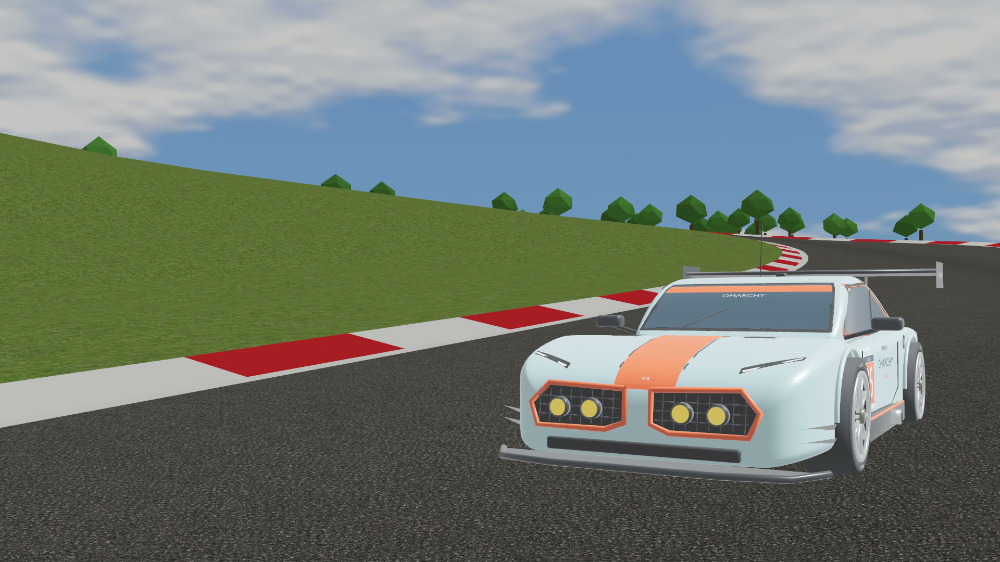](docs/images/todora-short.mp4)

A free arcade racer with **51 scaled real-world circuits**, a ghost to chase and purple sectors to earn. Take the **OMARCHY GT #95** out alone, share a screen with up to four players, or trade the car for a chicken in **Bonkers mode**.

**[Download for Mac](https://github.com/oliverlukschander/todora/releases/download/v0.12.0/Todora.dmg)** · **[Download for Linux](https://github.com/oliverlukschander/todora/releases/download/v0.12.0/Todora-linux-x86_64.tar.gz)** · [Watch 20 seconds of gameplay](docs/images/todora-short.mp4)

Apple Silicon Mac · x86-64 Linux · Free · Open source under MIT

## Find your next favourite corner

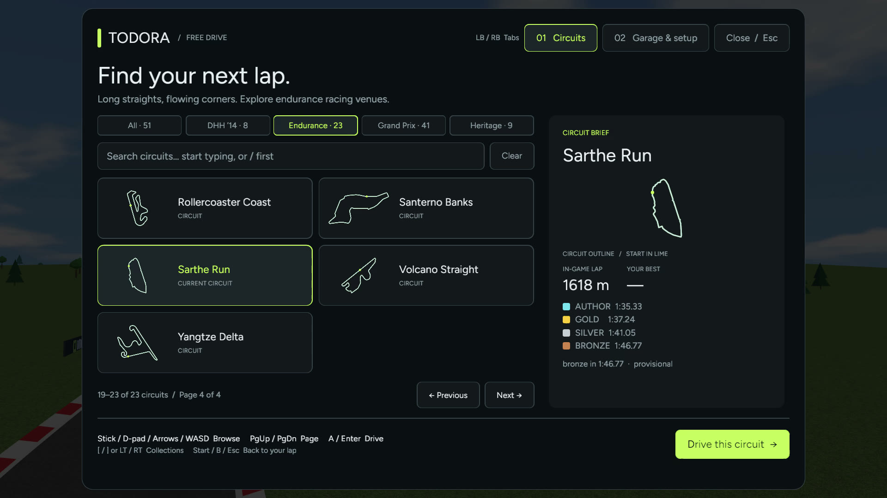

51 circuits traced from public GPS data, scaled down for quick laps. Learn Parco Reale, climb Ardennes Loop or stretch your legs on Sarthe Run; browse **All / DHH ’14 / Endurance / Grand Prix / Heritage**, or search for a circuit.

## Meet your GT

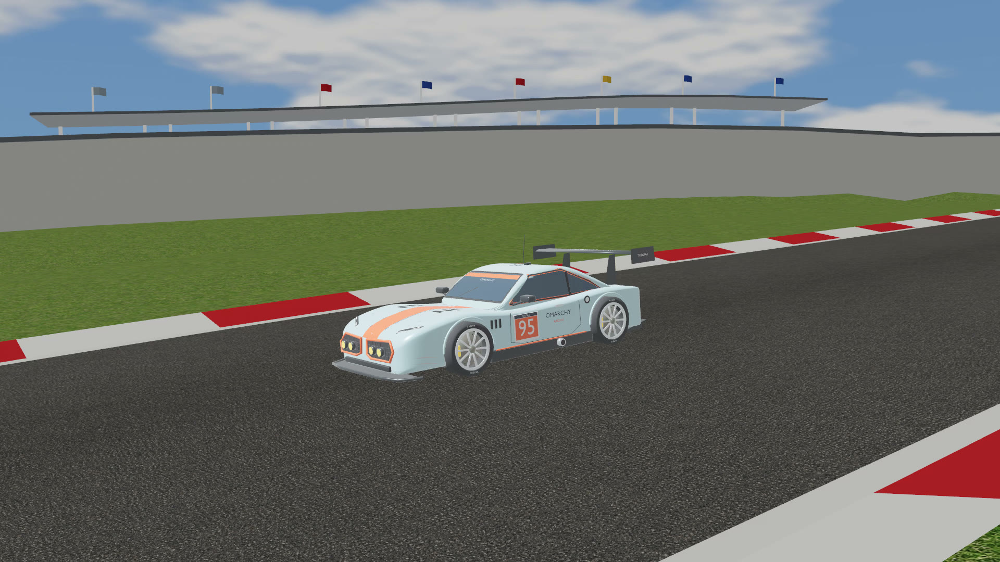

Pale blue, orange and number 95. The **OMARCHY GT** is an original endurance car built in Blender, with yellow lamps, a rear wing and a cockpit you can drive from.

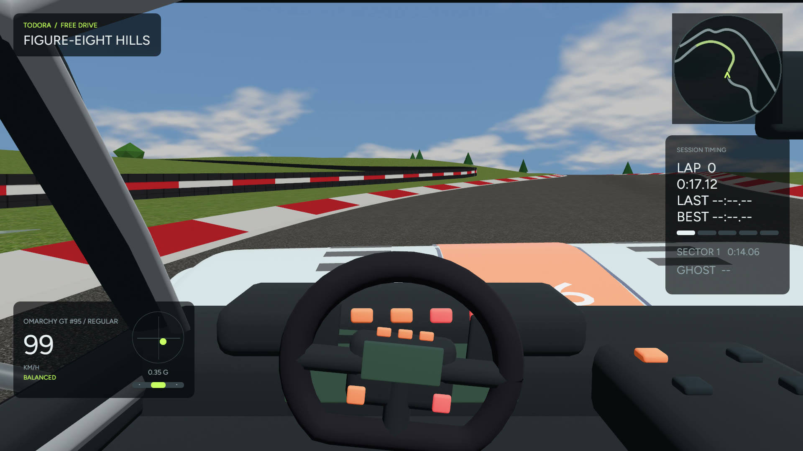

Watch the shift lights climb and the wheel turn. Press **V** to switch between chase, bonnet and cockpit views.

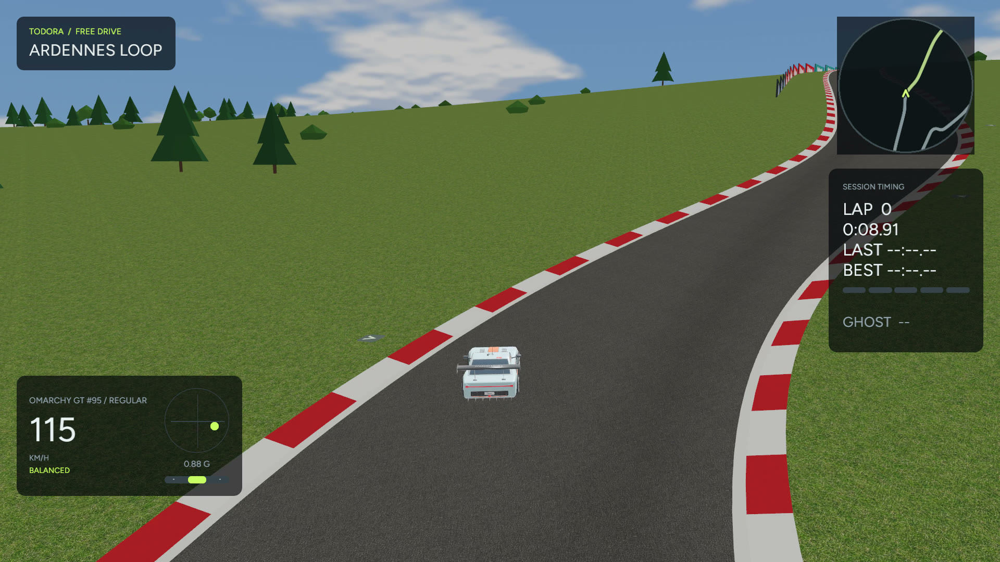

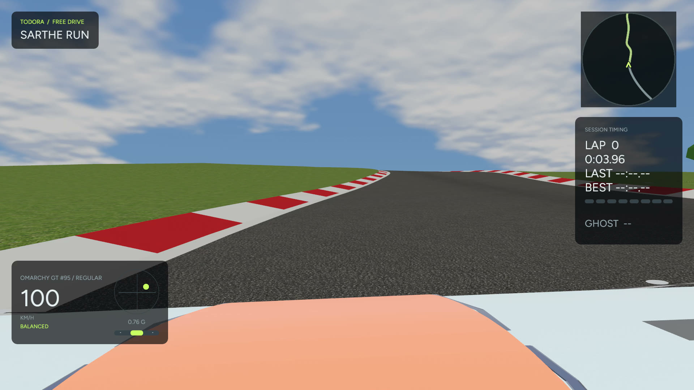

## Make the next lap count

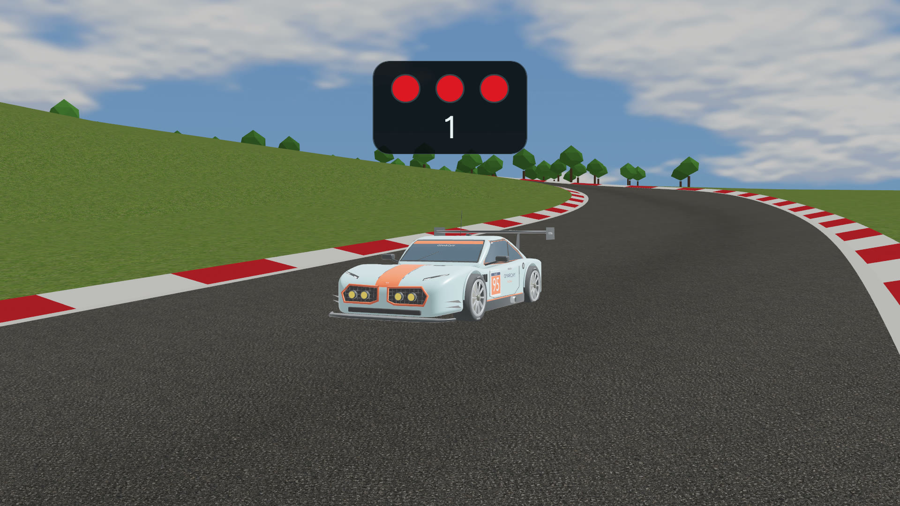

Hold the throttle and wait for green. The clock starts at the line: every timed lap is a flying lap.

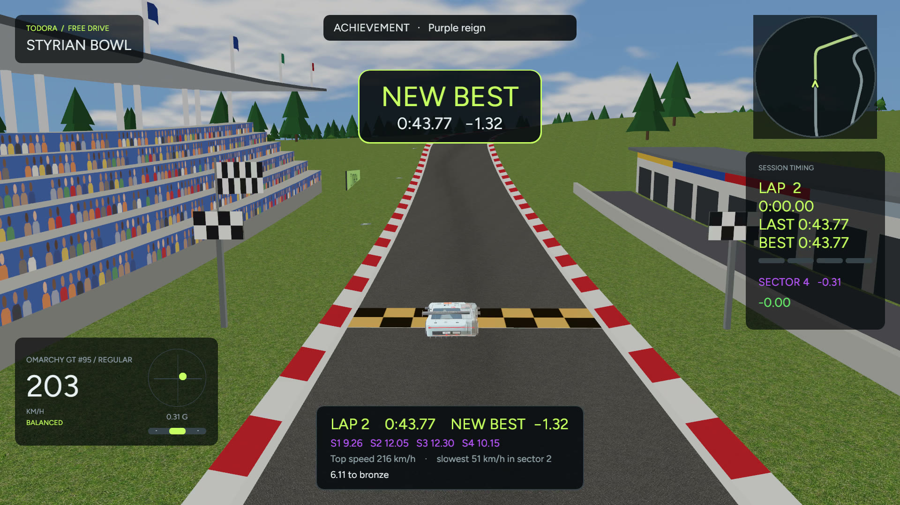

**Purple** beats your fastest-ever sector. **Green** beats that sector of your best lap; **yellow** leaves you something to find. Chase medals and a **NEW BEST**, with a waving flag and a cheer from the stands.

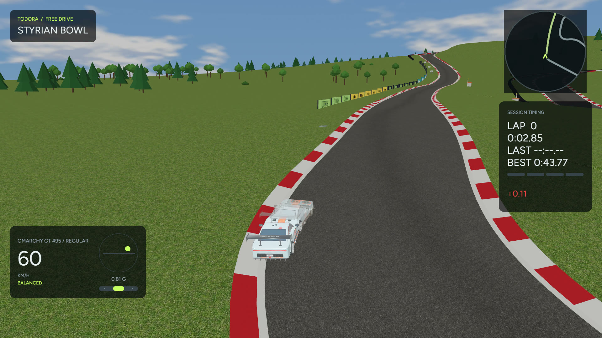

Your best lap comes back as a ghost. Go online for **world, country and rivals boards**, download a ghost to race, or take on the **weekly challenge**. The world leaderboard re-drives every submitted lap to check it.

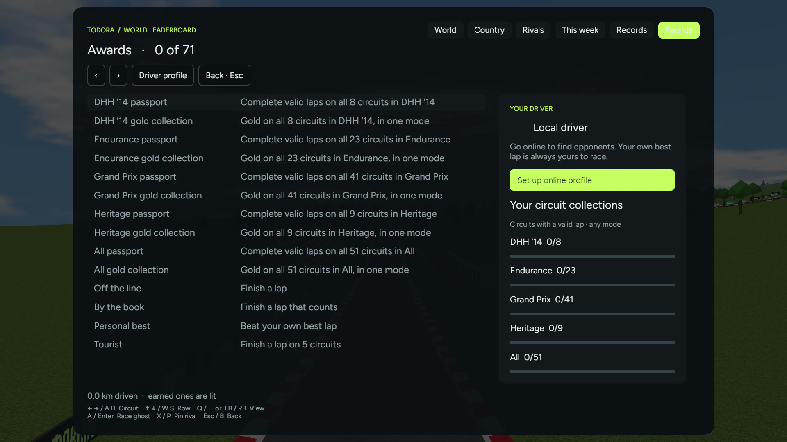

**71 achievements** give you reasons to keep exploring. Find them in **Awards**, with extra Bonkers awards waiting when you venture off the sensible route.

## Bring the sofa rivalry

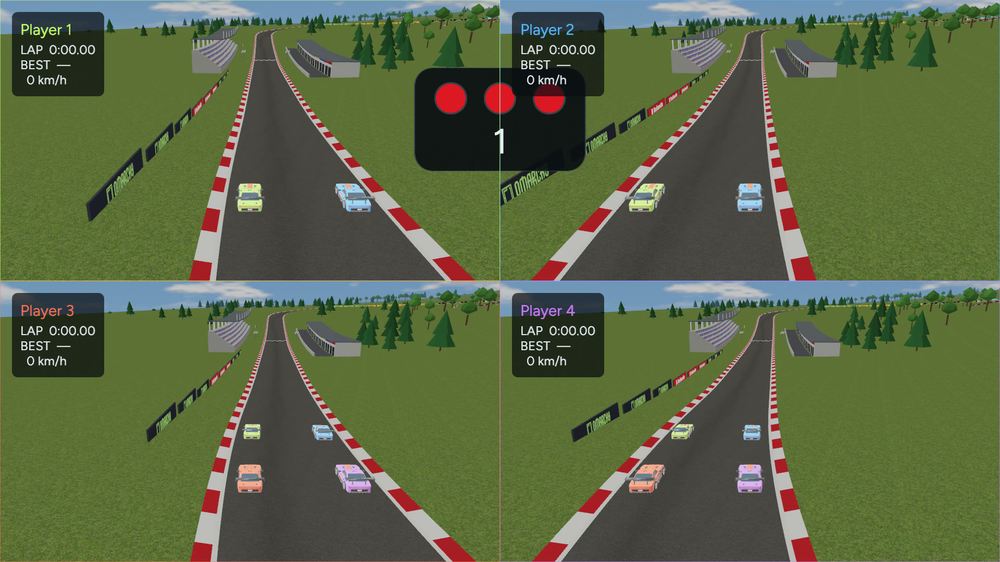

**Two to four players. One screen.** Mix keyboards and gamepads, pick a circuit and chase the fastest lap of the session. Included in the regular download. [Local play and controls →](docs/local-play.md)

## Keep the lap. Find the shot.

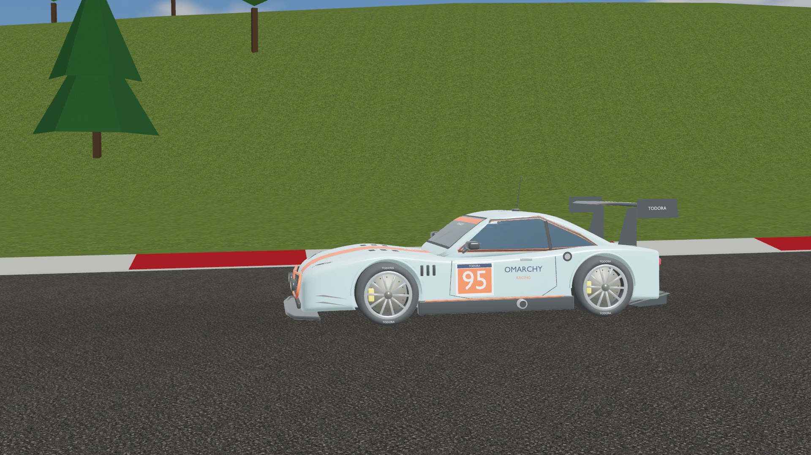

Replay a lap, then use photo mode to find your angle; pictures land in **`~/Pictures/Todora`**. Stands, marshals, trees, boards and braking markers line the road, right down to the chequered finish.

## Make it yours

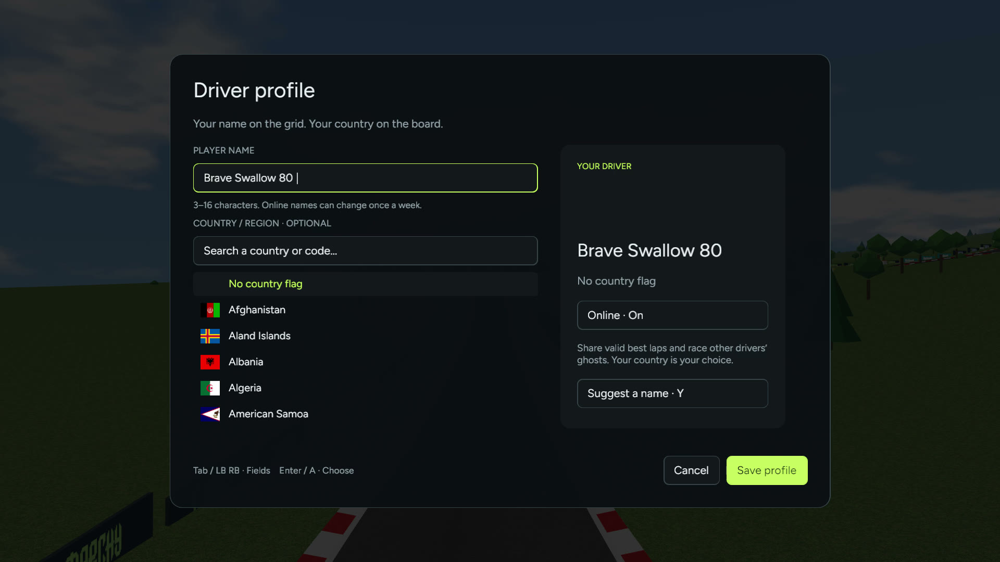

Choose your driver name and country flag. Todora also speaks **German, French, Spanish and Italian**.

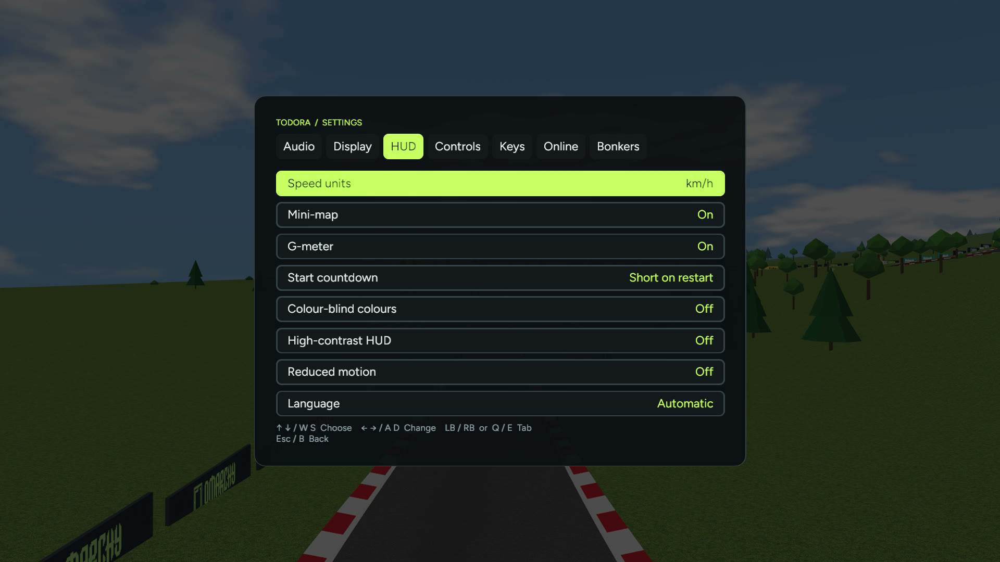

Colour-blind palettes, high contrast and reduced motion help keep the race readable. Tap-to-hold pedals and **Beginner assists** give you more ways to get comfortable.

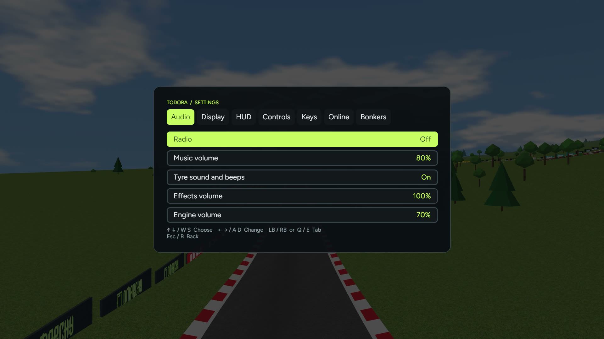

Hear a recorded engine climb through the gears and tyres work at the limit. Turn on **CLIamp’s Omarchy radio** for a live soundtrack; the radio needs an internet connection.

## Or ride a chicken

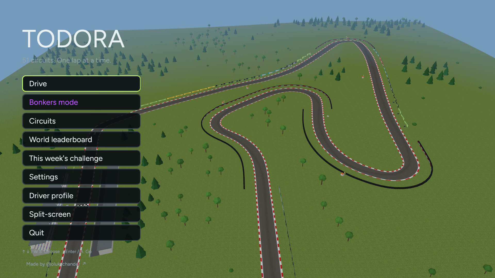

Choose **Bonkers mode** on the title, or press **F9**. Chickens, ducks, a bathtub and a shopping cart take on hills, boost pads, jump pads and cows, under neon, to techno.

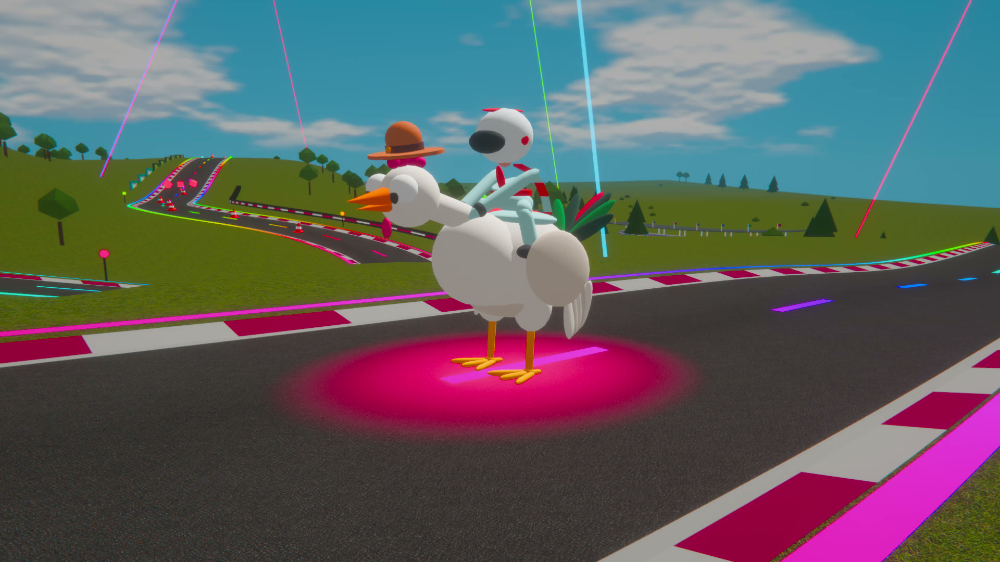

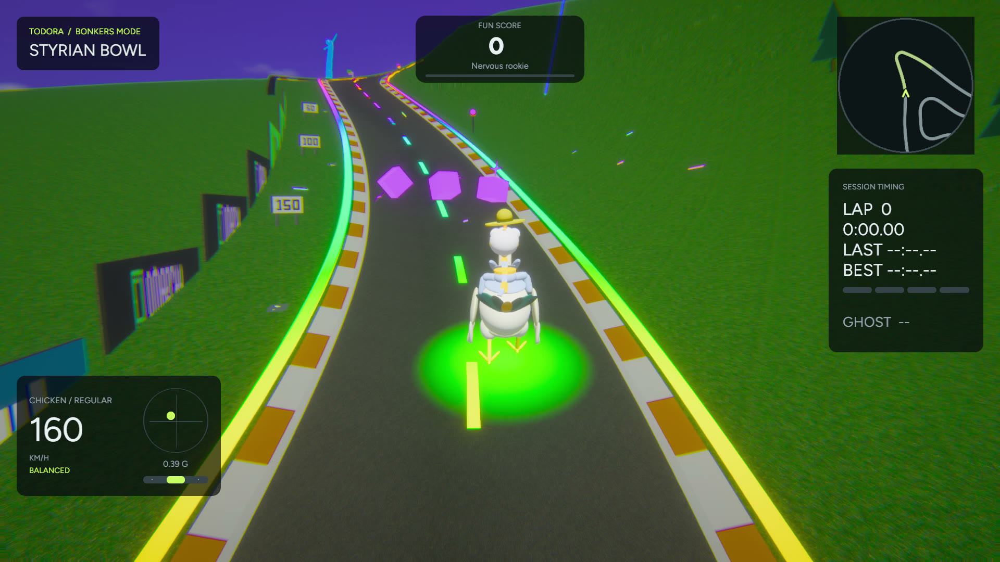

**Bonkers laps never count.** The leaderboard physics stay unchanged, and Todora always opens in plain mode. [Meet the chaos →](docs/bonkers-mode.md)

## Download 0.12.0

| Platform | Download | Start playing |
| --- | --- | --- |
| Apple Silicon Mac | [Todora.dmg](https://github.com/oliverlukschander/todora/releases/download/v0.12.0/Todora.dmg) | Drag Todora to Applications. Signed ad hoc, not notarized: first launch may need permission in **System Settings → Privacy & Security**. |
| x86-64 Linux | [Todora-linux-x86_64.tar.gz](https://github.com/oliverlukschander/todora/releases/download/v0.12.0/Todora-linux-x86_64.tar.gz) | Unpack and run `Todora/todora`. Built on Debian bookworm (glibc 2.36); needs ALSA, udev, Wayland or X11, and a Vulkan driver. |

[SHA256SUMS](https://github.com/oliverlukschander/todora/releases/download/v0.12.0/SHA256SUMS) · [Release notes](docs/releases/v0.12.0.md)

The separate **Todora-Multiplayer.dmg** is a Game Center development build for Macs registered in its provisioning profile. [Tester setup →](docs/testing/multiplayer.md)

## Play

**WASD** or a gamepad gets you moving. On a pad, steer with the left stick, accelerate with RT and brake with LT.

| Key | Action |
| --- | --- |
| **T** | Circuits |
| **C** | Garage |
| **V** | Camera |
| **G** | Ghost |
| **R** | Restart |
| **Esc** | Pause and settings |
| **F9** | Bonkers mode |

## Build from source

Install Rust and the [platform dependencies](docs/testing/linux.md), then run from this checkout:

```sh
cargo run --locked
```

Use `cargo run --locked --release` for an optimized build. Built with Rust and Bevy. [Design history and development notes →](docs/design-history.md)

## License and credits

Made by [Oliver Lukschander](https://github.com/oliverlukschander). Original code and artwork are [MIT licensed](LICENSE); third-party assets retain their own licenses. [Full licenses and credits →](LICENSES.md)

Thanks to [Tomislav Bacinger and contributors](https://github.com/bacinger/f1-circuits) for circuit traces, and © OpenStreetMap contributors via [track-atlas](https://github.com/tobi/track-atlas) for additional geometry. Elevation: **Open-Meteo / Copernicus DEM GLO-90**, CC BY 4.0, scaled for the game. [Circuit sources and attribution →](assets/tracks/CREDITS.md)

Engine recording by **enginemusic**; tyre recording by **audible-edge (Tom Haigh)**, loop by **qubodup**, CC BY 3.0. [Audio sources and modifications →](assets/audio/CREDITS.md) Radio is streamed separately.

Todora is not affiliated with or endorsed by any real circuit, racing series, team or car manufacturer. Circuit names in the game are Todora’s own. [Leaderboard admission rules →](docs/online-integrity.md)
